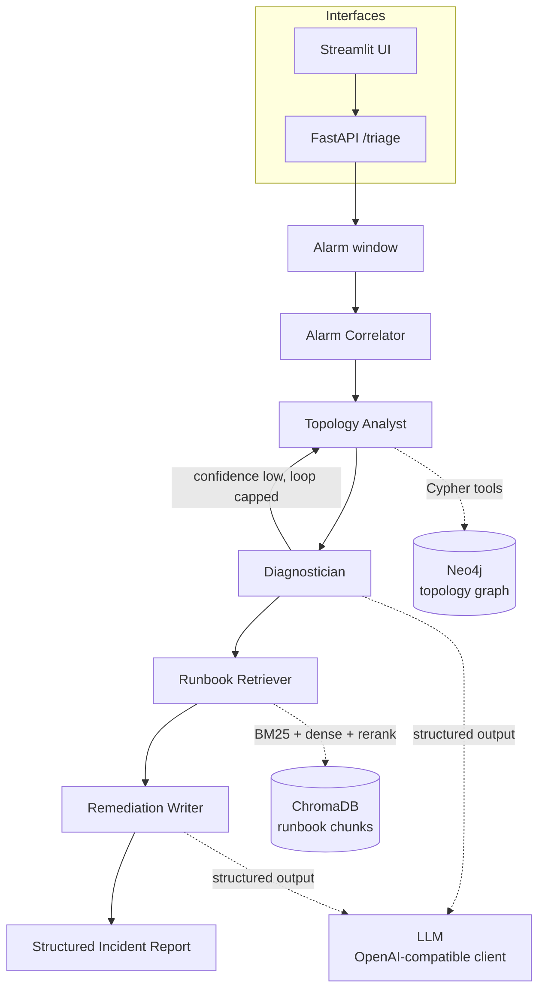

# NOC Triage Copilot

AI copilot for telecom NOC alarm triage: multi-agent root-cause analysis (LangGraph),
knowledge-graph RAG over network topology and runbooks (Neo4j + hybrid retrieval), a
QLoRA fine-tuned small model benchmarked against a large API model, and low-latency
serving (vLLM).

See [SPEC.md](SPEC.md) for the full project specification.

## The problem

A burst of network alarms during an outage is noisy and hard to triage quickly: dozens
of alarms fire across many devices, only some of which are actually related to the root
cause, and a human operator has to (1) figure out which alarms belong together, (2)
localize the actual failing component using the network topology, (3) identify the type
of failure, and (4) find and apply the right remediation steps — all under time
pressure. This project builds an AI copilot that does this end to end, with its
reasoning grounded and cited at every step.

## Architecture



## All data is synthetic

Every alarm, topology node, and incident in this project is generated by a simulator
(`src/noc_copilot/simulator/`) that plants ground truth as it goes: it builds a
realistic hierarchical mobile network topology, injects one of 8 failure types at a
specific node, propagates realistic downstream alarms through the *real* topology graph
(respecting redundancy — a dual-homed node doesn't lose connectivity from a single
failed uplink), and mixes in background noise, flapping, and duplicate alarms. The
simulator remembers the true root-cause node, root-cause type, affected nodes, and
correct runbook for every incident — alarm messages are LLM-paraphrased in each vendor's
terse log style so they don't leak the runbook's own vocabulary. That hidden ground
truth is what makes every metric in this README a real, checkable measurement rather
than a vibe. See `SPEC.md` for the full simulator design.

## Quickstart

```bash
# 1. Install dependencies (Python 3.12, uv)
uv sync --extra dev

# 2. Copy .env.example to .env and fill in a free Gemini API key
#    (https://aistudio.google.com/apikey)
cp .env.example .env

# 3. Start Neo4j
docker compose up -d neo4j

# 4. Generate the synthetic dataset and load the topology graph
uv run --extra dev scripts/01_generate_data.py
uv run --extra dev scripts/01_load_graph.py

# 5. Run the test suite
uv run --extra dev pytest tests/ -v

# 6. Start the API and UI
uv run --extra dev uvicorn noc_copilot.api.app:app --app-dir src --port 8000 &
uv run --extra dev streamlit run src/noc_copilot/ui/app.py
```

Then open the Streamlit URL it prints, pick a test incident, and run it through the
full triage pipeline.

## Results

All numbers below are generated by `scripts/make_report.py` directly from
`results/*.json` — nothing here is estimated or invented.

### Synthetic dataset (Phase 1)

Seed: `42`. Topology: **533 nodes**, **545 links**.

| Node type | Count |
|---|---|
| CORE_ROUTER | 3 |
| AMF | 1 |
| UPF | 1 |
| AGG_ROUTER | 6 |
| PREAGG_ROUTER | 18 |
| CSR | 72 |
| GNB | 72 |
| CELL | 216 |
| POWER | 72 |
| SYNC | 72 |

**1000 incident bundles**, by failure type:

| Failure type | Count |
|---|---|
| fiber_cut | 125 |
| site_power_failure | 125 |
| router_hardware_fault | 125 |
| sync_loss | 125 |
| microwave_degradation | 125 |
| cell_congestion | 125 |
| cooling_failure | 125 |
| core_overload | 125 |

By split (no root-cause node shared across splits):

| Split | Count |
|---|---|
| train | 700 |
| dev | 160 |
| test | 140 |

**22201 total alarms**, noise ratio **0.376** (8352 background/noise alarms mixed in with the real signal).


### Runbook retrieval (Phase 2)

Recall@k / MRR per retrieval mode, on queries built from test-split incidents' real
(non-noise) alarm evidence against the known-correct runbook:

| Mode | N queries | MRR | Recall@1 | Recall@3 | Recall@5 |
|---|---|---|---|---|---|
| bm25 | 140 | 0.819 | 72.1% | 91.4% | 94.3% |
| dense | 140 | 0.843 | 75.0% | 95.7% | 98.6% |
| hybrid | 140 | 0.886 | 79.3% | 97.1% | 100.0% |
| hybrid+rerank | 140 | 0.872 | 80.0% | 93.6% | 97.9% |


### End-to-end triage evaluation (Phase 3)

Full LangGraph pipeline, custom ground-truth metrics on the test split:

| Model | N | RCA top-1 | RCA top-3 | Root-node exact | Root-node 1-hop | Affected-node F1 | Latency p50 | Latency p95 |
|---|---|---|---|---|---|---|---|---|
| gemini-3.5-flash-lite | 40 | 95.0% | 97.5% | 100.0% | 100.0% | 91.3% | 51.7s | 104.2s |

_Latency includes free-tier rate-limit backoff baked into the measurement — not representative of raw inference speed. Cost figures (not shown in this table; see the raw results files) are hypothetical, computed at the model's published paid-tier rate; actual spend on the free tier was $0._


#### Ablation: graph tools on vs. off

| Condition | N | RCA top-1 | RCA top-3 | Root-node exact | Root-node 1-hop | Affected-node F1 | Latency p50 | Latency p95 |
|---|---|---|---|---|---|---|---|---|
| Full system (graph tools on) | 40 | 95.0% | 97.5% | 100.0% | 100.0% | 91.3% | 51.7s | 104.2s |
| No graph tools (alarms only) | 40 | 95.0% | 100.0% | 97.5% | 100.0% | 91.3% | 44.0s | 78.2s |


#### Ablation: retrieval mode

| Mode | Latency p50 | Mean tokens | Faithfulness | Answer relevancy | Context precision | Context recall |
|---|---|---|---|---|---|---|
| bm25 | 21.3s | 523 | 0.103 | 0.461 | 0.858 | 0.540 |
| dense | 22.2s | 529 | 0.067 | 0.433 | 0.695 | 0.683 |
| hybrid | 23.0s | 515 | 0.031 | 0.482 | 0.671 | 0.578 |
| hybrid+rerank | 51.7s | 2585 | 0.378 | 0.578 | 0.692 | 0.536 |

_RCA/node-match/F1 metrics are identical across modes by design — the diagnosis is made before retrieval runs, so only the final written report (and hence RAGAS scores) differs by mode; see results/ablation_retrieval_modes.json for the full (mode-invariant) custom metrics. `hybrid+rerank` is the default mode and runs the full pipeline (correlator, topology analyst, diagnostician, retriever, writer); the other three modes reuse that run's diagnosis and only rerun the retriever+writer tail, which is why their latency/token counts are much lower — that's the cost of the full diagnostic pass, not a property of those retrieval modes themselves. RAGAS run on a 10-row/mode sub-sample, not the full test split, due to free-tier rate limits. Faithfulness scores are likely underestimates: RAGAS only credits claims supported by retrieved runbook text, but the Remediation Writer also legitimately grounds claims in topology/alarm evidence, which RAGAS can't see._


### QLoRA fine-tuning comparison (Phase 4)

_TBD. QLoRA fine-tuning of Qwen3-8B (non-thinking mode, 4-bit, rank-16 LoRA) completed successfully on a Colab T4 — eval loss 0.596, 89.4% token accuracy on the held-out dev set, no overfitting. The adapter is saved; serving it (base-vs-fine-tuned comparison via vLLM) is blocked on free-tier Colab GPU quota and hasn't been completed yet. See `src/noc_copilot/finetune/` for the dataset builder, training script, and merge script — all tested/working except the final merge-and-serve step._


### vLLM serving latency benchmarks (Phase 5)

_TBD — Phase 5 (vLLM serving + latency benchmarks) not yet run._


## Honest limitations and next steps

- **Phase 4/5 incomplete**: QLoRA training succeeded (see above) but the model was never
  served or benchmarked — this is blocked on free-tier Colab GPU quota, not a design gap.
  Picking this up requires either patience with Colab's quota reset, a different GPU
  platform (Kaggle's free tier has a separate quota), or a paid GPU rental.
- **Retrieval benchmark vocabulary leakage (partially addressed)**: alarm messages are
  LLM-paraphrased independently of the runbook text specifically to reduce this, but the
  underlying failure-type taxonomy still correlates the two to some degree by
  construction (one author wrote both).
- **RAGAS faithfulness likely underestimates true groundedness**: it only credits claims
  supported by retrieved runbook *text*, not the topology/alarm evidence citations the
  Remediation Writer also legitimately uses.
- **RAGAS sample size**: scored on a 10-row-per-mode sub-sample (not the full test
  split) due to free-tier rate limits (15 requests/minute, 500/day on the model used).
- **Free-tier rate limits shaped a lot of this project's pacing**: both the LLM API
  (Gemini) and the GPU (Colab) have tight free-tier quotas that directly constrained
  sample sizes and phase sequencing. A paid tier on either would remove these
  constraints without any code changes (the LLM client is swappable via `.env`).
- **Single-seed topology**: all results are on one seeded synthetic topology/incident
  set (seed=42). Re-running with other seeds would show variance not captured here.
